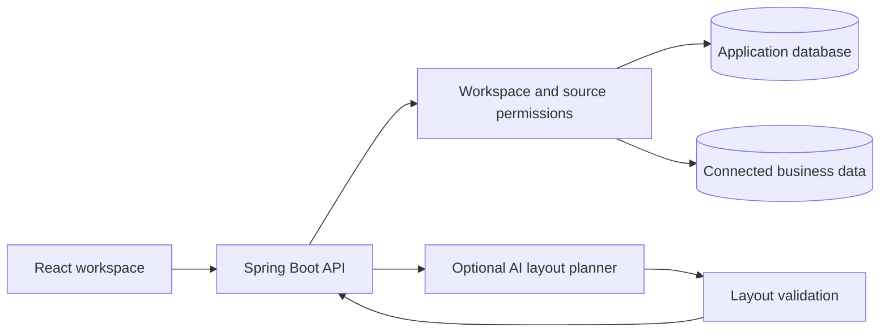

<div align="center">
  
  <h1>Ask a question. Build a clearer picture.</h1>
  <p>An analytics workspace with persistent project chats, editable dashboards, and governed data access.</p>
  <p><strong>React · TypeScript · Spring Boot · Java 21 · SQL Server</strong></p>
  <p><a href="#quick-start">Quick start</a> · <a href="#features">Features</a> · <a href="docs/CURRENT_FEATURES_AND_FLOWS.md">User guide</a></p>
</div>

---

## Features

| Capability | What it does |
| --- | --- |
| Project-based chat | Groups conversations under Projects; saves messages, answers, charts, and query evidence in SQL Server. |
| Dashboards from prompts | Builds editable layouts from natural language using available live or sample report sources. |
| Visual report builder | Provides drag-and-drop charts and tables, field bindings, reordering, and JSON layout import/export. |
| Sample analytics | Includes five synthetic workbook reports and an executive dashboard with 5,130 demonstration invoices. |
| Governed exploration | Supports metric definitions, permission-checked queries, saved reports, and query evidence. |
| Dashboard publishing | Creates token links requiring workspace sign-in and the viewer's current source permissions. |
| Modern interface | Includes responsive layouts, light/dark themes, animations, and keyboard-accessible controls. |

Metric Mint is the application brand. Its chart-and-leaf logo is available as [an SVG wordmark](frontend/public/metric-mint-logo.svg) and [an SVG icon](frontend/public/metric-mint-mark.svg). Browser checks accept `METRIC_MINT_TEST_USERNAME` and `METRIC_MINT_TEST_PASSWORD`.

Existing SQL Server database/schema names, Java namespaces, demo account IDs and historical migration identifiers retain their original names for compatibility with installed data. Toscana also identifies the connected operational system; it is not the application brand.

A cost-conscious analytics MVP that connects business data, defines trusted metrics, and lets users explore results through dashboards and an AI-assisted question interface.

## Components

- `backend/` — Spring Boot API, authentication, data-source management, governed queries, and AI orchestration.
- `frontend/` — React application for dashboards, charts, data-source setup, and natural-language analysis.
- `database/` — SQL Server schema, migrations, and local seed data.
- `docs/` — supporting product and technical documentation.

The UI is original and inspired by open-source shadcn dashboard patterns. No paid or proprietary template assets are copied into this project.



## Quick start

1. Install Java 21, Maven, Node.js/npm compatible with the installed Vite version, and SQL Server.
2. Clone this repository and copy `.env.example` to `.env`. Configure `DB_URL`, `DB_USERNAME`, and `DB_PASSWORD` with your local connection.
3. Create an empty application database called `ToscanaInsightHub`, or use your own database name in `DB_URL`. Spring Boot applies Flyway migrations and seeds synthetic records automatically. Legacy scripts in `database/` are not needed for a fresh Flyway-managed install.
4. Start the services in separate terminals using the commands below.
5. Open **http://localhost:5173**. The local demo login is `admin` / `admin`; change `DEMO_PASSWORD` before exposing the service.

```powershell
# Terminal 1, from the repository root
cd backend
mvn spring-boot:run

# Terminal 2, from the repository root
cd frontend
npm ci
npm run dev
```

IntelliJ IDEA's bundled Maven also works. Replace `mvn` with the executable for your installed version:

```powershell
& 'C:/Program Files/JetBrains/IntelliJ IDEA Community Edition 2024.3.5/plugins/maven/lib/maven3/bin/mvn.cmd' spring-boot:run
```

Set `JAVA_HOME` to JDK 21 if needed. The frontend proxies `/api` to port 8090. Health is available at **http://localhost:8090/actuator/health**.

Only synthetic data is bundled. Real operational views require the separate connected database and expected source tables; they are unavailable on a fresh installation until that source is configured. Start with **Sample data** in AI dashboards and try: “Create a dashboard with queue management and utilization.”

Keep `.env` local. Credentials, runtime logs, screenshots, database backups, and the original business spreadsheet are excluded from version control. The development MVP uses HTTP Basic authentication; use HTTPS and appropriate identity/secrets management before production deployment.

## Expected Local URLs

- Frontend: `http://localhost:5173`
- Backend API: `http://localhost:8090/api`
- SQL Server: `localhost:1433`

After signing in, the app opens a chat workspace. In **Projects**, choose **New project** to organize conversations, select a project, then choose **New chat** and ask a question such as **Show monthly invoice volume**. **General** contains chats without a named project. Projects and conversations are private to their creator within the workspace and are stored in SQL Server; refreshing, signing out, closing the browser, or restarting the backend does not delete them. Deleting a chat removes its saved history.

Saved responses retain their original answer, result rows, charts and query evidence. Reopening history shows the saved result; send a new question to fetch current data. Follow-ups use the last successful query while checking current permissions again. The server saves each prompt before running analytics. If a backend restart interrupts a pending answer, the prompt remains available to retry. **Stop response** stops waiting in the browser; server work may finish and its saved answer will appear when the chat is reopened. A failed network request may not have reached the server; the UI reports failures instead of claiming the answer was saved. Chats that vanished before database saving was enabled cannot be recovered from the previous in-memory UI.

For invoice details, default-workspace administrators can ask **Show the latest invoice in the duplicate queue**. This reads the live I2P source (`NeonExternal`, LOB 92), includes the current assignee, and searches both **Duplicate Check** and **Duplicate Identifier** unless one is named. Latest means creation time, with row ID as the tie-breaker. Evidence includes the SQL, source and filters. Detail rows are not sent to the optional AI summary provider. Unsupported questions or filters ask for clarification. Broad AP summaries use the separate `AccountsPayable_External` source (LOB 90); queues are not substituted with regions.

The executive dashboard uses 5,130 synthetic invoices stored in SQL Server by Flyway migration V4. Sign in locally with `admin` / `admin`, then use **Connected data** to switch to operational source views. See [Features and user flow](docs/CURRENT_FEATURES_AND_FLOWS.md) for dashboard controls and verification commands.

**Reports → Excel report collection** contains five database-backed demo reports from the supplied IGP workbook. Open a report or the executive dashboard and choose **Publish dashboard** to save a view and create a token link requiring workspace sign-in. Manage/revoke links under **Published dashboards**. Links use the current app address; internet access requires deployment.

**Reports → Report templates** lets analysts create a layout or upload a JSON template, bind charts and tables to report fields, preview database results, and save the template. Download the layout to reuse it; exports contain bindings, not result rows or credentials. Start with [Operations pulse](frontend/public/templates/operations-report.json). Template uploads use this versioned JSON format; Excel, Word, and PowerPoint documents are not imported.

Choose a workbook sample report or a saved report from Explore as the data source for each widget. Saved reports run with the signed-in viewer's permissions whenever the template is opened or refreshed. Templates are visible within the workspace; only their owner or an administrator can edit or delete them. Publishing freezes the layout while keeping database results live, and the link requires both its token and a sign-in to the same workspace. Changes to source reports and access permissions still apply.

To build without a file, choose **Create template**, then drag chart or table tiles from the palette onto the canvas. Drag a widget's grip onto another widget to insert it before that widget, or drop at the end. **Configure** opens its data bindings; width and move buttons also work with a keyboard or on mobile. Preview, save, and publish when ready.


## Dashboards from natural language

Choose **AI dashboards** in the sidebar (or **Reports ? Report templates ? Create with AI**). Select **Live data** or **Sample data**, describe the dashboard, then choose **Generate dashboard**. Try:

> Create an invoice dashboard with monthly volume and status distribution.

Review the generated preview, edit chart types and layout, then **Save template**. Saved dashboards appear in the template library and survive restarts. **Publish dashboard** creates the existing token link requiring workspace sign-in; the published layout is fixed and data is fetched with the viewer's current permissions.

Generation uses only sources available to the current account. Live and sample data are separate choices. The built-in live invoice sources cover Accounts Payable (LOB 90) and require an administrator in the source's default workspace; saved governed reports retain their own access rules. Unsupported filters or unavailable data return a clarification instead of silently substituting a different result.

Set `AI_PROVIDER=openai`, `OPENAI_API_KEY`, `OPENAI_MODEL`, and `OPENAI_BASE_URL` in the local `.env`, then restart Spring Boot to enable the AI provider. The dashboard planner sends the prompt and permitted source/field metadata, not result rows or connection credentials. It uses [structured model output](https://developers.openai.com/api/docs/guides/structured-outputs?api-mode=responses), then the server validates source IDs, fields, chart bindings and permissions before previewing any data. The model cannot execute SQL. Without a configured provider, supported requests produce an explicitly labeled **Starter layout**, not an AI-generated result. Provider errors remain visible and can be retried.

## Verification

From `backend/`:

```powershell
mvn test
mvn package
```

From `frontend/`:

```powershell
npm ci
npm run build
node --test tests/dashboard-data.test.mjs tests/report-csv.test.mjs tests/template-layout.test.mjs tests/chat-state.test.mjs tests/display-label.test.mjs
```

The latest local backend verification passed **136 tests**. Browser checks cover chat persistence, dashboard generation, editing, saving, publishing, themes, and mobile layouts. These are local results; GitHub CI is not configured. Real AI-provider calls were not exercised because no key was configured.

With both services running, browser checks use Playwright and Microsoft Edge:

```powershell
# From frontend/. Set PLAYWRIGHT_MODULE if installed outside this project.
node tests/ai-dashboard-smoke.cjs
node tests/templates-smoke.cjs
node tests/chat-smoke.cjs
```

Browser scripts accept `METRIC_MINT_TEST_USERNAME` and `METRIC_MINT_TEST_PASSWORD`. Run mutation checks only against a development workspace. See the [user guide](docs/CURRENT_FEATURES_AND_FLOWS.md) for additional checks and current limitations.

## Maintainer

[Saurabh](https://github.com/saurabh-codespace) · Full-stack software developer · HCLTech, Noida.
