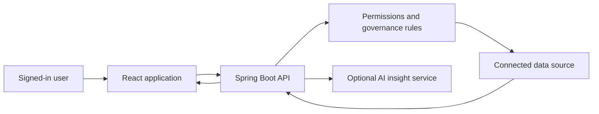

# Metric Mint: Features and User Flow

Last updated: 12 October 2026.

This guide explains what the application can do and how each part works. It uses simple language and describes features that are available now.

## 1. What This Application Does

Metric Mint helps teams understand Invoice-to-Pay data.

You can:

- View important invoice numbers on one screen.
- Ask questions about the data in normal language.
- Create dashboards with charts, KPIs, and AI insights.
- Open ready-made report templates.
- Connect and monitor data sources.
- Create and approve business metrics.
- Control data access.
- Review system activity and audit history.

## 2. Sign In

For local development, use:

- Username: `admin`
- Password: `admin`

Flow:

1. Open the application.
2. Enter the username and password.
3. The backend checks the account.
4. After a successful login, the current browser tab keeps the session.
5. Signing out removes the session.

Important: change the default password before using the application outside local development.

## 3. Main Navigation

The left menu contains:

- **Overview**: executive invoice dashboard, with a switch to connected Invoice-to-Pay data.
- **New chat**: ask questions inside a project or General.
- **AI dashboards**: describe a dashboard and review its generated charts and tables.
- **Explore**: build governed data queries.
- **Data sources**: connect and monitor source systems.
- **Metrics & KPIs**: invoice measures and definitions, with a switch to connected business performance.
- **Reports**: open large report templates.
- **Governance**: manage metrics, catalogue information, access, users, and audit history.
- **Settings**: change workspace limits and appearance.
- **Help center**: read quick-start instructions and common answers.

Other useful controls:

- Press `Ctrl+K` to search pages and actions.
- Use the bell to check source-health notifications.
- Use the workspace menu to open workspace settings.
- Use the sun or moon button to switch theme.

The sidebar, dialogs, tables, and wide reports show scrollbars when their content does not fit on the screen.

## 4. Overview Page

The default **Executive analytics** view reads 5,130 sample invoices from SQL Server through the authenticated `/api/dashboard/sample-invoices` endpoint. Flyway migration `V4__dashboard_sample_invoices.sql` creates and seeds `toscana_insights.dashboard_sample_invoices` when the backend starts. These are synthetic records, shared across signed-in workspaces and separate from connected business data.

The dashboard includes:

- Total invoice value, invoice count, completion rate, and average processing time, with preceding-period comparisons.
- Five-day SLA compliance, touchless processing, exceptions, and outstanding value.
- Daily volume/value trends, payment status, and business-unit performance.
- Business-unit and 7/30/90-day filters.
- Invoice search, status filtering, pagination, and CSV export of the filtered rows.
- Light/dark themes and a mobile navigation menu.

The sample dates are fixed as of **9 October 2026**; date filters are relative to that snapshot, not today's date. All sample amounts are USD. **Metrics & KPIs** explains the calculations and labels its targets as demo benchmarks.

Select **Connected data** to open the existing operational view, which shows:

- Total work items.
- Completed work items.
- Open work items.
- Completion rate.
- Active lines of business.
- Monthly invoice volume.
- Status distribution.
- Average ageing.
- Exception queue workload.

Use **Refresh cache** to request fresh connected data.

## 5. Projects and saved chats

Use **Projects** in the left sidebar to organize conversations. Choose **New project**, enter a name, select the project, then choose **New chat**. **General** holds chats without a named project. Select a saved chat to reopen its messages, tables, charts and evidence.

Projects and chats are private to the signed-in account and workspace. They persist in SQL Server through page refreshes, sign-out, browser restarts and backend restarts. Chat deletion removes the saved conversation; sign-out only clears it from the current screen. Saved answers are snapshots from their original execution time. Ask again for current data.

The backend saves the prompt before calculating an answer, uses the same permission-checked analytics path as a one-shot question, and stores the full result afterward. Follow-ups reuse the last successful query. Unsupported questions ask for clarification. Execution errors remain in history with an option to retry; a backend restart marks interrupted answers as failed while retaining their prompts.

**Stop response** stops waiting in the browser. An answer already running on the server can still finish and appear when the conversation is reopened. If the network request never reached the server, the UI reports the failure and the prompt must be retried.

Examples: **Show monthly invoice volume**, or **Show the latest invoice in the duplicate queue**. The latter uses the live I2P source and requires a default-workspace administrator.

## 6. Create a Dashboard from Natural Language

Open **AI dashboards** in the sidebar, or **Create with AI** in the report template library. Choose **Live data** or **Sample data** and describe the dashboard.

Live example:

`Create an invoice dashboard with monthly volume and status distribution.`

Sample example:

`Create a dashboard with queue management and utilization.`

Choose **Generate dashboard**. The resulting preview opens in the existing editor: change chart types, fields, titles and layout, then choose **Save template**. Reopen it from the template library after a refresh or restart. **Publish dashboard** creates a token link requiring sign-in to the same workspace. Published data still uses the viewer's source permissions.

The AI planner receives the prompt and permitted source/field metadata. It proposes a layout, while the server validates its bindings and loads database results. No result rows or connection credentials are sent to the planner. Sample widgets remain clearly marked. The fixed live invoice summaries cover Accounts Payable (LOB 90) and require a default-workspace administrator; other users can use their permitted saved reports. Unsupported requests ask for clarification; generation never saves or publishes automatically.

If the AI provider is not configured, supported requests use clearly labeled **Starter layouts**. These are limited to the available report summaries and are not AI-generated. For arbitrary language interpretation, configure the provider below. A provider failure shows an error rather than pretending AI succeeded.

### AI Configuration

Create a local `.env` file from `.env.example` and set:

```text
AI_PROVIDER=openai
OPENAI_API_KEY=your-key
OPENAI_MODEL=your-model
OPENAI_BASE_URL=https://api.openai.com/v1
```

The backend automatically loads `.env` when started from the repository root or the `backend` folder.

## 7. Available Charts

Dashboards and reports support:

- Horizontal bar.
- Column.
- Line.
- Area.
- Pie.
- Donut.
- Stacked bar.
- Radar.
- Scatter.
- Heatmap.
- KPI.
- Data table.

You can change the chart type without changing the underlying data.

## 8. Explore

Use Explore to build a governed query.

You can:

- Select a metric.
- Group by time or business dimensions.
- Choose day, month, or year.
- Add a date range.
- Add filters.
- Set a row limit.
- View results as a table or chart.
- See freshness, warnings, metric version, filters, and generated SQL.
- Save a private or shared report.
- Export permitted results to CSV or PDF.

## 9. Data Sources

Supported source types include:

- SQL Server.
- PostgreSQL.
- SAP API.
- Salesforce API.
- Icertis API.
- SharePoint.
- REST API.
- File dumps.
- CSV uploads.

You can add, test, pause, resume, and run sources. You can also view previous runs and errors.

Passwords and tokens are not shown in API responses. The application stores credential references or encrypted secrets.

## 10. Metrics

The **Metrics & KPIs** page opens the executive sample metrics and their definitions. Select **Connected data** for:

- Total invoices.
- Open invoices.
- Completion rate.
- Average ageing.
- Results by line of business.

Use **New metric** to open the metric editor in Governance.

## 11. Reports

### Excel report collection

The Reports page now opens five reports named in `SBD - IGP Support - Reports Supported (Utilization).xlsx`, sheet **IGP Activity Tracker Details**. The workbook supplied report names/descriptions, not measurements. All displayed figures below are explicitly synthetic examples stored in SQL Server.

| Workbook row | Report | Example measures |
| --- | --- | --- |
| 2 | Queue Management Dashboard | Intake, resolutions, open backlog, SLA exceptions, weighted cycle time |
| 3 | On Hold Report | Held cases, cases over 48 hours, weighted hold time by category |
| 17 | CSAT Dashboard - Power BI (Development, Enhancement, Maintenance) | Responses, satisfied responses, weighted satisfaction rate and daily trend |
| 18 | Savings data collection | Automation/process savings in USD and hours saved by week |
| 40 | Utilization Dashboard - PBI | Available, billable and training hours; weighted team utilization |

Each report has eight stored aggregate rows (40 total), KPI cards, seven chart/table choices, a complete detail table, and CSV export. Use report search/category filters to find a report, then **Explore report**. The sample snapshot is 9 October 2026. CSV text values are protected against spreadsheet formula interpretation. These are illustrative versions of the named reports, not live integrations or reproductions of every workflow in the spreadsheet.

Flyway V5 creates/seeds `toscana_insights.workbook_sample_rows`. The authenticated API is `GET /api/workbook-reports` or `GET /api/workbook-reports/{id}`. No external enterprise connection is needed to open this collection.

The updated UI uses Recharts, Lucide icons and Motion for React, with colorful report previews, a refreshed dashboard, responsive layouts, dark mode, and reduced-motion support.

### Publish a dashboard

1. Open an Excel report or the executive invoice dashboard. Select the chart or invoice filters you want to save.
2. Choose **Publish dashboard**, enter a name, and select **Publish and create link**.
3. Copy the link. It contains an opaque random token, with no username or password.
4. A recipient opens the link and signs in with an existing account in the same workspace. Viewers can read published dashboards; owners, administrators and analysts can publish.
5. Open **Reports → Excel report collection → Published dashboards** to find saved links. The publisher or a workspace administrator/owner can **Revoke link**.

Publishing stores a dashboard definition in `toscana_insights.app_published_dashboards` (Flyway V6). Executive views preserve business unit, period and chart; workbook views preserve report and chart. Refreshing the link reloads the saved definition. Revocation blocks subsequent loads. It cannot erase a view or export someone already received.

Published URLs use `#/published/{token}` and require both a valid token and workspace sign-in. The current app is local; `127.0.0.1` links are reachable on this machine only. Internet use requires hosting, HTTPS and properly configured user accounts/origins. Publication currently covers executive/sample workbook dashboards, not generated AI multi-widget artifacts.

### Connected I2P reports

Choose **Connected I2P reports** for the existing enterprise-source workbooks.

The Reports page uses large cards so previews and actions are easy to see.

Each report card shows:

- A live preview.
- Report name and description.
- Category and source.
- Record count and status.
- A clearly visible **Open report** button.

The full report opens in a wide, scrollable dialog. You can switch between every supported chart type.

If a report needs a source, use **Connect source**.

## 12. Governance

Governance contains four areas.

### Metrics

- Create and edit metric definitions.
- Test and verify metrics.
- Approve metrics.
- View older versions.
- Roll back to an older version.

### Catalogue and Joins

- View tables and columns.
- Add descriptions and owners.
- Mark sensitive columns.
- Define and test table relationships.

### Access and Members

- Create row-level access rules.
- Add workspace members.
- Assign owner, admin, analyst, viewer, or embed roles.

### Usage and Audit

- Set query limits.
- Set maximum rows and timeout.
- Set the data freshness limit.
- View daily usage.
- Review important user and system actions.

## 13. Settings

The Settings page lets an administrator:

- Change the daily query limit.
- Change the maximum result rows.
- Change the query timeout.
- Change the freshness limit.
- See queries used today.
- Choose the light or dark Metric Mint theme.

## 14. Safety Rules

The application protects data by using:

- Password hashing.
- Workspace-based access.
- Role checks.
- Row and column rules.
- Read-only analytics queries.
- Parameterized filter values.
- Query timeouts and row limits.
- Encrypted source secrets.
- Audit history.

## 15. Simple System Flow



The dashboard layout planner receives permitted source metadata, not result rows. The separate optional chat insight service receives bounded governed results. Neither service connects directly to the source database.

## 16. Run and Check the Application

Frontend:

```powershell
cd frontend
npm run dev
```

Backend:

```powershell
cd backend
mvn spring-boot:run
```

Checks:

```powershell
cd frontend
npm run build
node --test tests/dashboard-data.test.mjs
node --test tests/report-csv.test.mjs

cd ../backend
mvn test
```

Health endpoint:

`http://localhost:8090/actuator/health`

With both services running, `node tests/browser-smoke.cjs` from `frontend/` checks login, database invoice counts, filtered KPIs, chart switching, CSV export, search, pagination, metric navigation, themes, and mobile layout. It requires Playwright and Microsoft Edge; set `PLAYWRIGHT_MODULE` to an existing Playwright installation if it is not available locally. Screenshots and the exported CSV are written to `frontend/test-results/`.

`node tests/reports-publishing-smoke.cjs` checks all five Excel reports, exports, token publishing, a fresh-session sign-in, saved chart reload, revocation, dark theme and mobile layout. `node tests/executive-publishing-smoke.cjs` verifies saved invoice filters, chart and KPIs. Both tests remove their test publications afterward.

`node tests/ai-dashboard-smoke.cjs` checks natural-language live/sample generation, validation and clarification, retry after a failed request, editable fields, save/reload, token publishing, fresh sign-in, and mobile layout. It deletes only the templates and publications it creates.

## 17. Current Limits

- The local `admin/admin` account is not suitable for production.
- Login uses HTTP Basic authentication, not company SSO.
- AI layout generation requires a configured provider. Without it, only supported starter requests can create layouts.
- The dashboard builder composes available report outputs; create a governed saved report first for custom calculations or filters.
- The workspace menu shows the current workspace; switching between several workspaces needs more backend support.
- Reports need connected source data.
